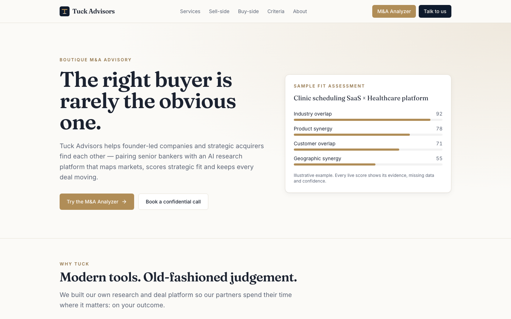
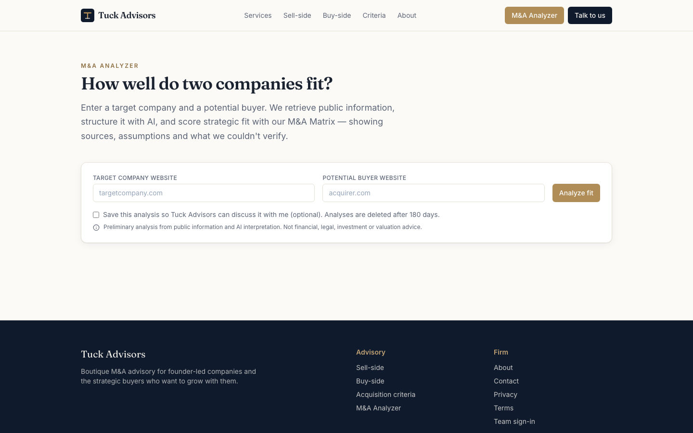
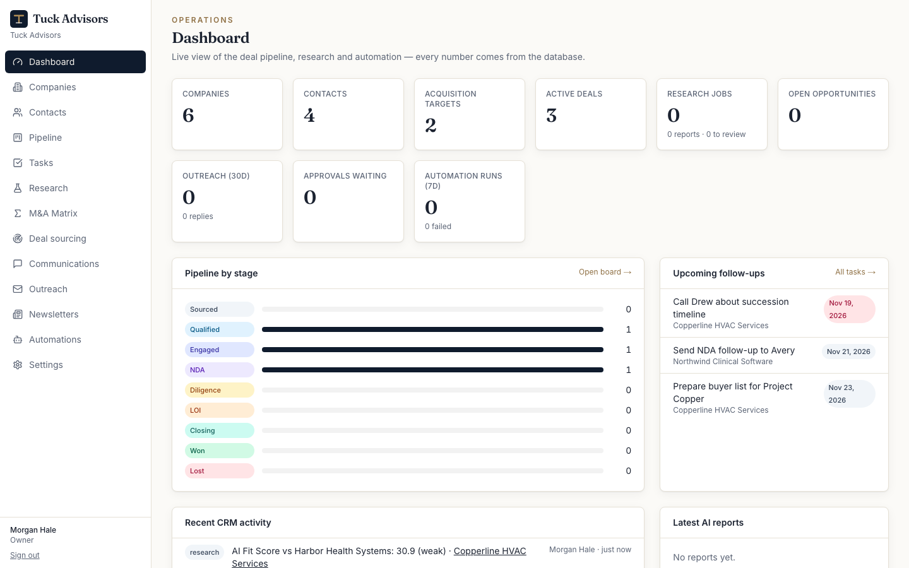
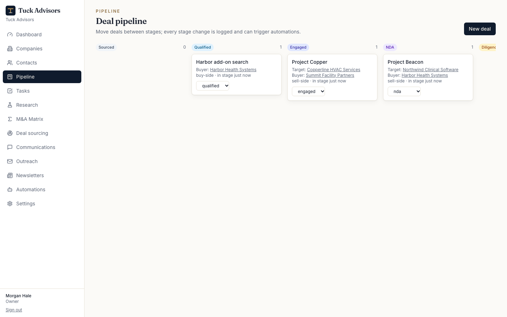
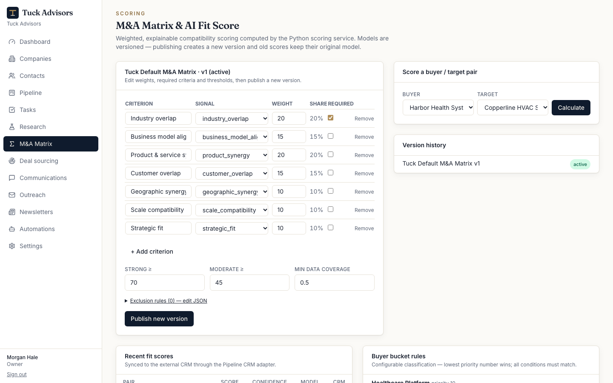
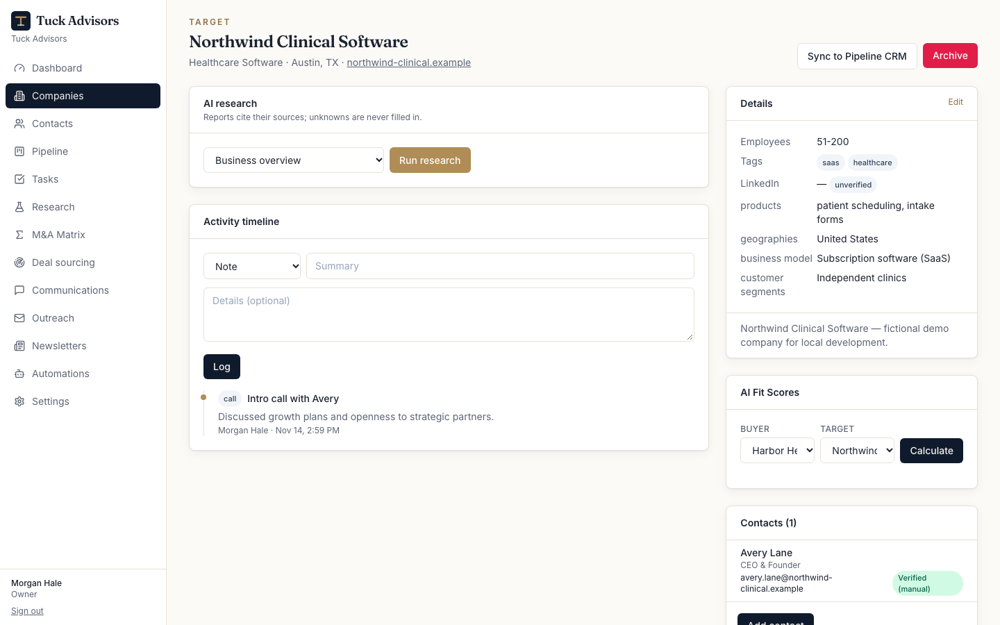
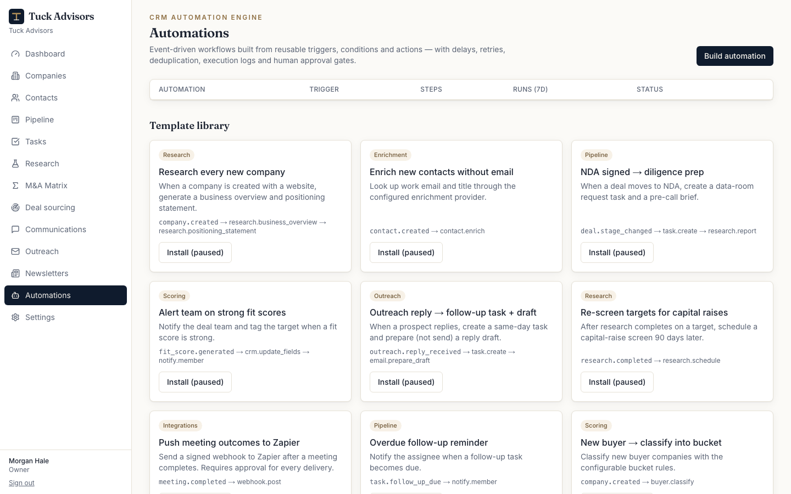
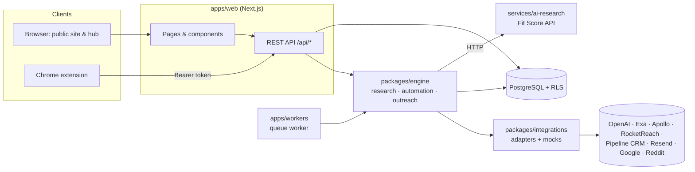

<div align="center">

# Tuck Advisors Platform

**An AI-powered M&A advisory platform — public website & M&A Analyzer, deal CRM, AI research engine,
explainable Fit Scoring, CRM automation, and a Chrome deal workstation.**


</div>

---

## Table of contents

- [Overview](#overview)
- [Screenshots](#screenshots)
- [Key features](#key-features)
- [Technology stack](#technology-stack)
- [Architecture](#architecture)
- [Getting started](#getting-started)
- [Configuration](#configuration)
- [Usage](#usage)
- [Project structure](#project-structure)
- [Testing](#testing)
- [Security](#security)
- [Deployment](#deployment)
- [Known limitations](#known-limitations)
- [Contributing](#contributing)
- [License](#license)

## Overview

Tuck Advisors is a boutique M&A advisory firm (fictional) whose traditionally manual work — researching
companies, finding buyers, scoring strategic fit, tracking deals and running outreach — is rebuilt here as an
AI-assisted, automated workflow.

The platform is made of five systems that share one backend and one PostgreSQL data model:

1. **Public website + M&A Analyzer** — a premium advisory site where anyone can compare a target company with a
   potential acquirer and get a sourced, explainable, preliminary fit assessment.
2. **Internal operations hub** — a secure, multi-tenant CRM and deal workspace for the advisory team.
3. **AI research engine** — business overviews, positioning statements, capital-raise screening, acquisition
   analysis, pre-/post-call notes and buyer classification, run as background jobs.
4. **CRM automation engine** — event-driven workflows with conditions, delays, retries, logs and approval gates.
5. **Chrome extension** — a Manifest V3 side panel that turns LinkedIn, Gmail and the CRM into a deal workstation.

Design principles: **evidence over invention** (every AI claim is labelled *sourced*, *assessment* or *unknown*;
revenue and contact details are never guessed), **humans approve anything client-facing**, and **least privilege**
everywhere (database row-level security, role checks, minimal browser permissions).

> **Portfolio / reference implementation.** All demo companies and people are fictional (`*.example` domains).
> Every external integration runs in a clearly labelled **mock mode** until credentials are configured, so the
> whole platform runs locally with no accounts and no Docker.

## Screenshots

| Public website | M&A Analyzer |
| --- | --- |
|  |  |

| Operations dashboard | Deal pipeline |
| --- | --- |
|  |  |

| M&A Matrix & AI Fit Score | Company workspace |
| --- | --- |
|  |  |

| Automation engine |
| --- |
|  |

## Key features

### Public platform
- Responsive advisory website: home, about, services, sell-side, buy-side, acquisition criteria, contact, privacy, terms.
- **M&A Analyzer**: validates two company URLs, retrieves public information (SSRF-guarded, robots.txt-respecting),
  builds structured profiles, scores fit with the M&A Matrix and shows synergies, risks, sources with retrieval
  timestamps, explicit unknowns and a not-advice disclaimer. Results are saved only with consent (180-day expiry).
- Lead capture with consent and honeypot spam protection; newsletter subscribe / one-click unsubscribe.

### Internal operations hub
- Dashboard with live database counts: pipeline, contacts, targets, research jobs, reports, outreach, follow-ups,
  approvals, automation health and team activity.
- Companies & contacts with custom fields, tags, search/filter, duplicate detection, CSV import/export,
  enrichment (Apollo / RocketReach) with honest verification status, and manual LinkedIn verification.
- Kanban deal pipeline (9 stages) with logged stage changes, tasks & follow-up reminders, activity timelines,
  meeting notes and internal comments.
- Research workspace, Reddit deal sourcing (official API), communications with AI-assisted email drafts,
  newsletters with research, editing and two-person approval, and an audit log.

### AI research engine
- Business overviews, positioning statements, capital-raise detection (always flagged for human review),
  acquisition analysis, similar-company and buyer discovery (Exa), pre-call briefs, post-call notes that create
  tasks, and configurable buyer-bucket classification.
- OpenAI structured outputs validated with Zod and repaired once on failure; invented source IDs are stripped
  and unsupported "sourced" claims are downgraded automatically.

### M&A Matrix & AI Fit Score (Python)
- Configurable weighted criteria, required criteria, exclusion rules, thresholds and minimum data coverage.
- Missing-data handling (`insufficient_data` instead of a fake number), confidence, evidence references and a
  human-readable explanation for every score.
- Versioned models and score history; results sync to Pipeline CRM through a dedicated adapter.

### CRM automation engine
- 12 triggers × 12 actions with conditions, delays, retry with exponential backoff, deduplication, execution
  logs, pause/disable, manual retry and human approval gates; a visual builder and a 9-recipe template library.

### Bulk outreach
- Segmentation, suppression lists, 30-day duplicate prevention, AI personalisation, unresolved-token and
  compliance checks, **approval by someone other than the author**, daily send limits, bounce/complaint/reply
  handling and campaign analytics. Nothing is ever sent automatically without approval.

### Chrome extension (Manifest V3)
- Side panel that adapts to LinkedIn company pages, LinkedIn profiles, Gmail threads and the Tuck CRM.
- Reads only visible page content; creates records with duplicate checks; logs Gmail threads (subject and
  participants only); exposes the AI deal toolkit. Permissions: `sidePanel` and `storage` only.
- Secure login with short-lived access tokens and rotating refresh tokens with reuse detection.

## Technology stack

| Layer | Technologies |
| --- | --- |
| Frontend | Next.js 15 (App Router), React 19, TypeScript, Tailwind CSS, TanStack Query, Lucide icons |
| Backend | Next.js route handlers, TypeScript, Zod validation, Node.js worker |
| Database | PostgreSQL (Supabase / Cloud SQL) with Row-Level Security; PGlite (Postgres in WASM) for local dev and tests |
| Auth | Supabase Auth or local scrypt credentials; HMAC-signed sessions; extension bearer + refresh tokens |
| AI & research | OpenAI, Exa, direct website retrieval; Python 3 + FastAPI + Pydantic scoring service |
| Integrations | Apollo, RocketReach, Pipeline CRM, Resend, Gmail / Google Docs / Google OAuth, Reddit Data API, Zapier / Apps Script webhooks |
| Extension | Chrome Manifest V3, Side Panel / Storage APIs, esbuild |
| Testing | Vitest, React Testing Library, Playwright, jsdom, pytest |
| Infrastructure | Docker, Docker Compose, Vercel (cron), AWS Lambda (SAM), Google Cloud SQL, Supabase, GitHub Actions |

## Architecture



Background work (research jobs, automations, outreach, newsletters, follow-ups) uses Postgres-backed queues
claimed with `FOR UPDATE SKIP LOCKED`, so any number of workers can run safely. More diagrams — research
workflow, enrichment, extension, automation engine and Fit Score calculation — are in [`docs/`](docs).

## Getting started

### Prerequisites

- **Node.js 22** and npm 10
- **Python 3.12+** (for the Fit Score service)
- Optional: Docker (production-like stack), Google Chrome (extension)

### 1. Clone and install

```bash
git clone git@github.com:Zubair-Zulifqar/Tuck-Advisors-Platform.git
cd Tuck-Advisors-Platform
npm install
```

### 2. Start the Fit Score service

```bash
cd services/ai-research
python3 -m venv .venv
.venv/bin/pip install -r requirements-dev.txt
.venv/bin/uvicorn tuck_scoring.app:app --port 8088
```

### 3. Start the web app (new terminal)

```bash
cp .env.example .env.local   # optional — the defaults below are enough locally
SEED_PASSWORD='choose-a-local-password' \
SCORING_SERVICE_URL=http://127.0.0.1:8088 \
npm run dev
```

An embedded PostgreSQL database (PGlite, stored in `.data/`) is created, migrated and seeded with fictional
demo data automatically. Open **http://localhost:3000**.

### 4. Load the Chrome extension (optional)

```bash
TUCK_API_BASE_URL=http://localhost:3000 npm run build -w @tuck/extension
```

Then open `chrome://extensions`, enable **Developer mode**, click **Load unpacked** and select `apps/extension/dist`.

### Production-like stack with Docker

```bash
cp .env.example .env    # fill in SESSION_SECRET and any provider keys
docker compose -f infrastructure/docker-compose.yml up --build
```

This runs PostgreSQL 16, the web app, the queue worker and the scoring service. See [docs/setup.md](docs/setup.md).

## Configuration

All configuration is via environment variables; see [`.env.example`](.env.example) for the full annotated list.
Secrets are read only on the server and never reach the browser or the extension bundle.

| Variable | Purpose | Required |
| --- | --- | --- |
| `APP_URL` | Public base URL (links in emails, CORS) | Production |
| `SESSION_SECRET` | ≥32-char HMAC key for session and extension tokens | Production |
| `DATABASE_URL` | PostgreSQL connection (Supabase / Cloud SQL). Omit locally to use PGlite | Production |
| `SEED_PASSWORD` | Password for the demo users (local only) | Local demo |
| `SCORING_SERVICE_URL`, `SCORING_SERVICE_TOKEN` | Python Fit Score service and optional bearer token | For scoring |
| `NEXT_PUBLIC_SUPABASE_URL`, `NEXT_PUBLIC_SUPABASE_ANON_KEY` | Use Supabase Auth for sign-in | Optional |
| `OPENAI_API_KEY`, `OPENAI_MODEL` | AI structuring and drafting | Optional (mock otherwise) |
| `EXA_API_KEY` | Web search, company and buyer discovery | Optional |
| `APOLLO_API_KEY`, `ROCKETREACH_API_KEY` | Contact enrichment | Optional |
| `PIPELINE_CRM_API_KEY`, `PIPELINE_CRM_FIT_SCORE_FIELD`, … | External CRM sync | Optional |
| `RESEND_API_KEY`, `RESEND_WEBHOOK_SECRET`, `NEWSLETTER_FROM` | Email delivery and delivery events | Optional |
| `GOOGLE_CLIENT_ID`, `GOOGLE_CLIENT_SECRET`, `GOOGLE_REDIRECT_URI` | Gmail / Google Docs | Optional |
| `REDDIT_CLIENT_ID`, `REDDIT_CLIENT_SECRET`, `REDDIT_USER_AGENT` | Reddit Data API | Optional |
| `WEBHOOK_SIGNING_SECRET` | Zapier / Apps Script signed webhooks | Optional |
| `CRON_SECRET` | Protects `/api/internal/cron` (Vercel Cron) | Serverless |
| `EXTENSION_IDS` | Allowed Chrome extension IDs for CORS | Production |

### Integration modes

`GET /api/health` and **Settings → Integrations** show each integration as `live`, `mock` or `disabled`
(secret values are never displayed).

| Integration | When not configured |
| --- | --- |
| OpenAI | Mock LLM: deterministic extraction from retrieved sources only, labelled in the UI. Refused in production unless `ALLOW_MOCK_PROVIDERS=true`. |
| Exa | Website-only retrieval; discovery features report that search is unavailable |
| Fit Score service | Scores return `insufficient_data` — never a fabricated number |
| Apollo / RocketReach | Mock always returns "not found" — never invents an email |
| Pipeline CRM | In-memory mock adapter |
| Resend | Sends are recorded as *simulated* |
| Google, Resend webhooks, Zapier | Disabled with a clear error |
| Reddit | Clearly labelled `[Sample data]` posts |

## Usage

Sign in at `/login` with one of the seeded accounts and your `SEED_PASSWORD`:

| Account | Role | Can do |
| --- | --- | --- |
| `owner@tuck.example` | Owner | Everything, including member management |
| `admin@tuck.example` | Admin | Approve outreach, newsletters and automation steps; manage integrations |
| `analyst@tuck.example` | Analyst | CRM editing, research, drafting outreach |
| `viewer@tuck.example` | Viewer | Read-only |

Typical workflow:

1. **Analyzer** — open `/analyzer`, enter a target and a buyer website, review the sourced assessment.
2. **Companies** — add or import companies; open one and run **AI research** (overview, positioning, capital raise…).
3. **M&A Matrix** — adjust weights and thresholds, publish a version, and score buyer/target pairs.
4. **Pipeline** — create deals and move them between stages; stage changes can trigger automations.
5. **Automations** — install a template (installed paused), review it, enable it, and approve gated steps.
6. **Outreach** — create a campaign, generate personalised drafts, submit, have a second person approve, then send.
7. **Extension** — sign in from the side panel, browse a LinkedIn company page or Gmail thread, and save to the CRM.

## Project structure

```
.
├── apps/
│   ├── web/                 Next.js app: public site, internal hub, REST API, Playwright E2E
│   ├── extension/           Chrome MV3 extension (background, content scripts, side panel, popup)
│   └── workers/             Standalone Postgres queue worker + retention job
├── packages/
│   ├── shared/              Zod schemas, roles & permissions, shared types
│   ├── db/                  SQL driver (pg / PGlite), migration runner, repositories, seed
│   ├── integrations/        Third-party adapters, HTTP retry/rate-limit core, crypto, mocks
│   └── engine/              Business logic: research, automation runtime, outreach, newsletters
├── services/
│   └── ai-research/         Python Fit Score engine (FastAPI, Lambda handler, batch scorer, pytest)
├── supabase/migrations/     PostgreSQL schema, RLS policies, audit triggers, retention
├── infrastructure/          Docker, docker-compose, AWS SAM, Cloud SQL and Supabase guides
├── docs/                    Architecture & module docs (with Mermaid diagrams) and screenshots
├── scripts/scan-secrets.mjs Pre-push secret scanner
└── .github/workflows/ci.yml CI: typecheck, tests, builds, secret scan
```

## Testing

```bash
npm run typecheck                 # all TypeScript workspaces
npm test                          # Vitest: shared, db, integrations, engine, web, workers, extension
npm run test:py                   # pytest: scoring engine, buckets, API, Lambda, batch
npm run build -w @tuck/web && npm run test:e2e   # Playwright against a production build (desktop + mobile)
npm run scan:secrets
```

**188 automated tests** pass, including database tests that run real migrations and verify RLS organisation
isolation in PostgreSQL (via PGlite), integration failure/retry/rate-limit tests for every adapter, the full
automation runtime, extension parser and XSS tests, and browser end-to-end flows. See [docs/testing.md](docs/testing.md).

## Security

- **Organisation isolation twice over:** every query filters by `organization_id`, and each request runs as the
  Postgres `authenticated` role with the caller's identity set, so Supabase RLS policies apply server-side.
- **Role-based permissions** checked on every API route; database triggers write field-level **audit logs**.
- HMAC-signed httpOnly sessions with Origin-based **CSRF** checks; extension bearer tokens with rotating, hashed
  refresh tokens and reuse detection.
- Zod validation on all input, **SSRF guard** with DNS resolution checks, robots.txt respect, strict CSP and
  security headers, rate limiting, signed webhooks with replay protection, AES-256-GCM credential helper.
- Platform rules respected: no LinkedIn/Gmail automation or scraping, official Reddit API, human approval for
  outreach, newsletters and outbound webhooks.

Details: [docs/security.md](docs/security.md).

## Deployment

Deployment templates are provided but **nothing is deployed automatically**:

- **Vercel** — `apps/web/vercel.json` with a 5-minute cron to `/api/internal/cron`.
- **Supabase / Cloud SQL** — apply `supabase/migrations` (`npm run db:migrate` with `DATABASE_URL`).
- **AWS Lambda** — SAM template for the scoring service in `infrastructure/aws/lambda`.
- **Docker** — images for web, worker and scoring service; `infrastructure/docker-compose.yml`.
- **Chrome Web Store** — `npm run package -w @tuck/extension` produces a store-ready zip.

See [docs/deployment.md](docs/deployment.md).

## Known limitations

- No production deployment has been performed; cloud configs are templates.
- Third-party adapters are tested against mocked HTTP responses. Apollo, RocketReach and Pipeline CRM endpoint
  shapes follow their public documentation and **must be verified** against your account before enabling.
- The Google OAuth consent flow is not wired into the UI yet; Docs export accepts a user-supplied token, and reply
  detection arrives via the signed inbound webhook (e.g. from Google Apps Script).
- Integration credentials are read from environment variables; the encrypted `integrations` table has no settings UI yet.
- The in-memory rate limiter is per instance; use Redis for multi-instance deployments.
- Legal pages are templates and require review by counsel.

Progress and phase status: [PROJECT_PROGRESS.md](PROJECT_PROGRESS.md).

## Contributing

Contributions and suggestions are welcome.

1. Fork the repository and create a branch: `git checkout -b feature/my-change`.
2. Keep business logic in `packages/engine`, provider code in `packages/integrations`, and validate inputs with Zod.
3. Add or update tests, then run `npm run typecheck`, `npm test`, `npm run test:py` and `npm run scan:secrets`.
4. Never commit `.env` files, credentials or real customer data — tests use fictional `*.example` data only.
5. Open a pull request describing the change and how it was tested.

## License

Released under the [MIT License](LICENSE). © 2026 Zubair Zulifqar.
