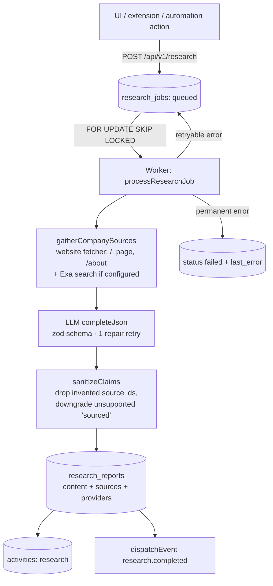
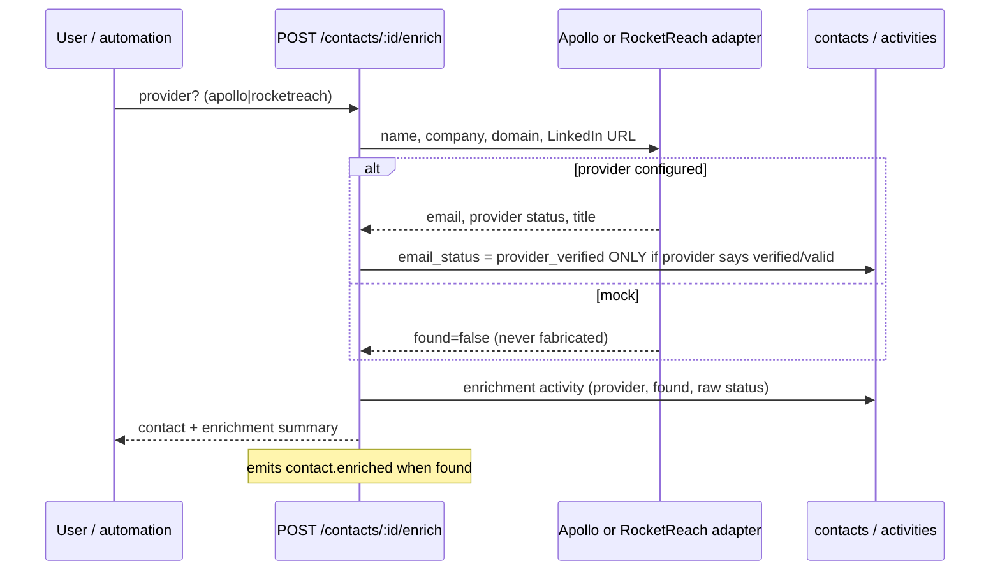

# AI research engine

Code: `packages/engine/src/research/` (`engine.ts`, `jobs.ts`, `heuristics.ts`, `reddit.ts`). Providers come from
`packages/integrations` (`llm.ts`, `research.ts`, `enrichment.ts`, `scoring.ts`).

## Workflow

Retries: provider errors marked `retryable` (timeouts, 5xx, 429) are re-queued with exponential backoff (30 s × 2^attempt,
max 3 attempts). Validation errors fail immediately with a readable reason (e.g. "Company needs a website or domain").

## Capabilities (`kind`)

| Kind | Output |
| --- | --- |
| `business_overview` | `CompanyProfile`: overview, industry, business model, products, customers, positioning, geography, revenue indicators, growth indicators — each a claim |
| `positioning_statement` | Statement, target customer, category, differentiators, proof points |
| `capital_raise` | News search (last 24 months) → signals `{status: possible\|likely\|confirmed_by_source, confidence, amountText, roundText, sourceIds}`; every signal `needsHumanReview: true`; signals without valid sources are dropped; report flagged `needs_review` |
| `acquisition_analysis` | Profile + similar companies + buyer candidates from acquisition news (flagged for review) |
| `similar_companies` | Exa `findSimilar` |
| `pre_call_notes` | Company/contact background, developments, acquisition interests, discussion points, questions, CRM history |
| `post_call_notes` | Summary, key points, action items (→ tasks), opportunities, follow-ups, **suggested** CRM updates (not auto-applied); logs a meeting activity |
| `buyer_classification` | Org's `buyer_bucket_rules` evaluated by the scoring service → `buyers.bucket` + explanation |

Discovery features need `EXA_API_KEY`; without it they return an explicit note rather than empty "results".

## Guardrails
- System prompt forbids guessing revenue, headcount, valuation, ownership or deal history.
- Mock LLM (no key, non-production only) builds outputs with `heuristics.ts` from retrieved text: sourced overview sentence,
  low-confidence assessments for industry/model/segments, `unknown` for positioning and revenue. Reports record `providers.mock`.
- Scoring facts are derived only from non-unknown claims (`profileToFacts`) or CRM fields (`companyRowToFacts`);
  `revenueUsd` only when `custom_fields.revenue_verified` is true.

## Enrichment workflow

Users can never set `provider_verified` directly; manual confirmation sets `manually_verified`.
