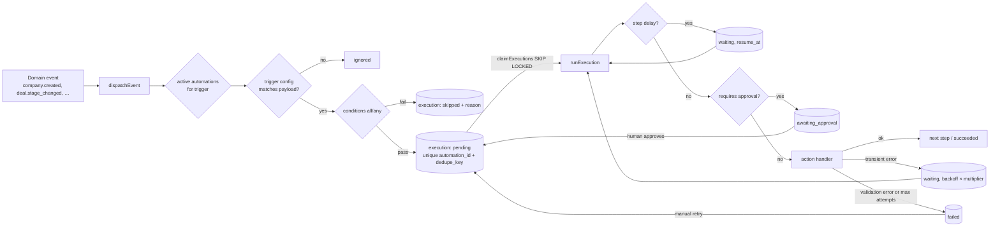

# CRM automation engine

Code: `packages/engine/src/automation/` (`runtime.ts`, `conditions.ts`, `actions.ts`), templates in `packages/engine/src/templates.ts`.
Definitions are validated by `automationInput` (`packages/shared/src/automation.ts`) and stored as JSON in `automations.definition`.

## Primitives

**Triggers:** `company.created`, `contact.created`, `research.completed`, `fit_score.generated`, `contact.enriched`,
`deal.stage_changed`, `outreach.reply_received`, `meeting.completed`, `task.follow_up_due`, `target.discovered`,
`schedule.cron`, `webhook.received`. `trigger.config` is an equality filter on the payload (e.g. `{ "to": "nda" }`).

**Conditions:** `{ path, op, value }` with `eq, neq, in, not_in, contains, gt, gte, lt, lte, exists, not_exists`; mode `all|any`.
Paths address `payload.*`, `event.type` and earlier `steps.<id>` outputs.

**Actions:**
| Action | Effect |
| --- | --- |
| `research.business_overview`, `research.positioning_statement`, `buyer.classify` | Enqueue research job |
| `research.report` (`params.kind`) / `research.schedule` (`kind`, `inDays`) | Enqueue now / later |
| `contact.enrich` | Apollo/RocketReach enrichment |
| `fit_score.calculate` | Score buyer/target pair |
| `crm.update_fields` | Whitelisted fields only (company: industry, kind, description, headquarters, employeeRange; contact: title) + `addTags` |
| `task.create` | Follow-up task (`title`, `dueInDays`, `assigneeUserId`) |
| `email.prepare_draft` | Draft email on the timeline — never sent |
| `notify.member` | System activity + optional assigned task |
| `webhook.post` | HMAC-signed POST to a public https URL (Zapier / Apps Script); **always requires approval** |

String params support `{{payload.x}}` tokens. Each step has `delaySeconds`, `requiresApproval`, `continueOnError`;
each automation has a retry policy (`maxAttempts`, `backoffSeconds`, `backoffMultiplier`) and optional `dedupeKey` template.

## Operations
- Execution log per run with every step's status, attempt count, output, error, approver.
- Status: `active | paused | disabled`. Executions of non-active automations are never claimed.
- `POST /api/v1/automations/executions/:id {action: approve|cancel|retry}` (approve needs `automation:approve`).
- Templates install **paused** so a human reviews before enabling. The UI includes a visual builder (trigger → conditions →
  steps) and a template library (research new companies, enrich contacts, NDA follow-up, strong-fit alerts, reply follow-ups,
  quarterly capital-raise re-screen, Zapier push, overdue follow-ups, buyer classification).
- Scale: hundreds of automations are rows, not code — dispatch is one indexed query per event
  (`automations_trigger_idx`), and execution is horizontally scalable via `SKIP LOCKED`.

Events are emitted by the API (company/contact created, stage changes, meetings), the research queue, fit scoring,
enrichment, outreach replies, Reddit conversions, overdue tasks, and the signed inbound webhook.
