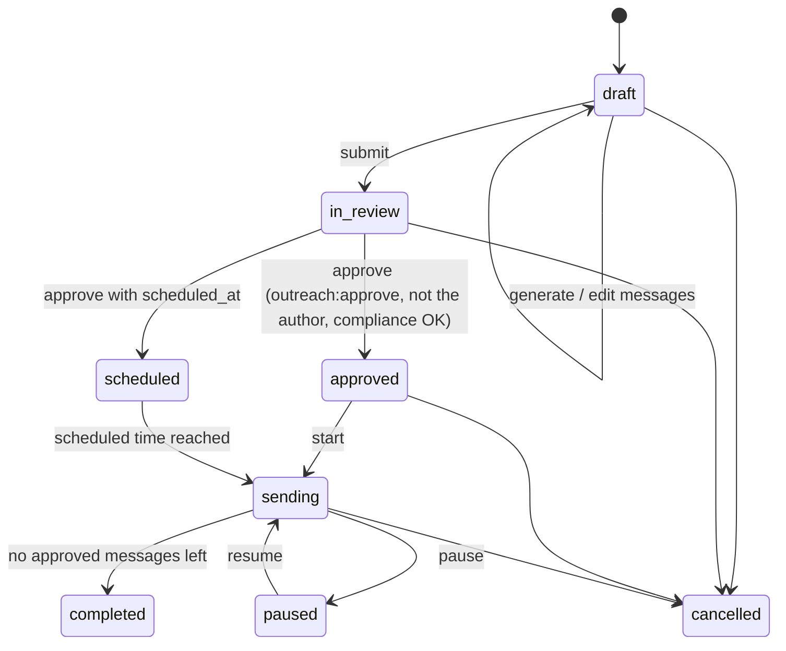

# Bulk outreach

Code: `packages/engine/src/outreach/campaigns.ts`; UI `/app/outreach`.

## Steps
1. **Create** campaign: subject/body templates (`{{first_name}}`, `{{company.name}}`, `{{company.industry}}`,
   `{{personalized_opener}}`, `{{sender_name}}`), sender, daily limit (1–500; >200 fails compliance), segment
   (tags, company kinds, verified-email only by default).
2. **Generate** per-recipient drafts. Excluded with reasons: suppressed, unverified email, contacted by another campaign in the
   last 30 days. Optional AI personalisation (one factual opener). A compliance footer with unsubscribe link is appended.
   Unresolved tokens are recorded on the message.
3. **Review & edit** each draft; **submit**.
4. **Approve** — DB check constraint requires `approved_by`; app requires a different person than the author and passes
   compliance checks (no unresolved fields, unsubscribe present, valid sender, limit ≤ 200).
5. **Send** (worker): only approved campaigns in `sending`; per-campaign daily budget; suppression re-checked at send time;
   `List-Unsubscribe` header; each send logged on the contact timeline. Without `RESEND_API_KEY` sends are **simulated** and
   labelled as such.
6. **Events**: Resend webhooks → delivered / bounced / complained (bounce & complaint → suppression list; bounce marks email
   invalid). Replies → `recordReply` (inbound webhook) → `outreach.reply_received` automation trigger.
7. **Analytics**: counts by status, reply rate, bounce rate.

Not implemented by design: automatic sending without approval, mailbox rotation, deceptive sender identities, or any limit circumvention.
