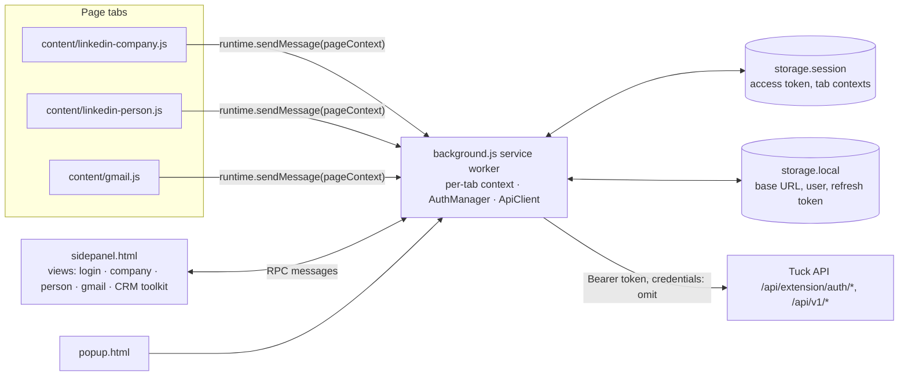

# Chrome extension (Manifest V3)

Code: `apps/extension` (see also its [README](../apps/extension/README.md)). Built with esbuild (`node build.mjs`, `--zip`
for a Web Store package). Default API base URL comes from `TUCK_API_BASE_URL` at build time (no secrets).

## Permissions
`sidePanel`, `storage`; `optional_host_permissions` requested at sign-in for the configured platform origin only. Content
scripts only on `linkedin.com/company/*`, `linkedin.com/in/*`, `mail.google.com/*`. No `<all_urls>`, `tabs`, `cookies`,
`scripting`, `webRequest`, remote code or web-accessible resources (enforced by `test/manifest.test.ts`).

## Context detection
`src/lib/context.ts` maps the tab URL to `linkedin_company | linkedin_person | gmail_thread | tuck_crm | unsupported`
(validated with the shared `pageContext` zod union). Content scripts parse only visible DOM text, debounce SPA navigation via
`MutationObserver`, and never click, scroll or make network requests.

## Backend contract
| Call | Purpose |
| --- | --- |
| `POST /api/extension/auth/login \| refresh \| logout` | Token lifecycle (refresh rotation, reuse detection) |
| `GET /api/v1/me` | Connection status |
| `GET /api/v1/match` | CRM matches by domain / LinkedIn URL / name / emails, with deals |
| `POST /api/v1/companies`, `/contacts` | Create (409 returns duplicates) |
| `POST /api/v1/activities` | Log Gmail thread (`externalRef: gmail:<threadId>`, idempotent) |
| `POST /api/v1/research`, `GET /research/jobs/:id` | AI deal toolkit |
| `POST /api/v1/contacts/:id/enrich`, `/fit-scores`, `/linkedin/verify` | Enrichment, scoring, manual verification |

CORS is allowed only for `chrome-extension://` origins listed in `EXTENSION_IDS` (any id in development).

## Auth & storage
Access token (15 min) in `storage.session`; rotating refresh token (30 days) in `storage.local`; single-flight refresh,
one retry on 401, explicit "session expired" state, logout revokes server-side. Third-party credentials never reach the extension.
