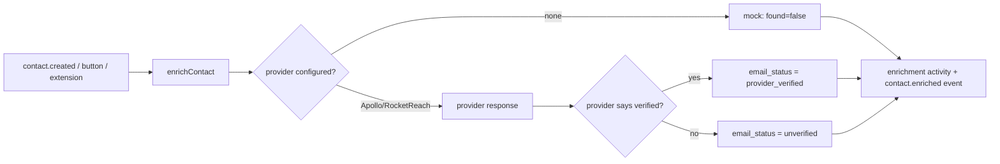

# CRM integration

## First-party CRM
Tables and repositories in `packages/db` (see [database-design.md](database-design.md)): companies, contacts, buyers,
acquisition targets, opportunities, deals (9 stages), activities, tasks, notes (activities of type `note`/`comment`),
custom fields (`custom_fields` jsonb), tags, CSV import/export, duplicate detection, audit history and RBAC.

## Pipeline CRM adapter
`packages/integrations/src/pipeline-crm.ts` implements `ExternalCrmAdapter`:

| Method | Request |
| --- | --- |
| `upsertCompany` | `POST /companies.json` or `PUT /companies/{id}.json` with `{ company: { name, web, description } }` |
| `upsertPerson` | `POST /people.json` / `PUT /people/{id}.json` with `{ person: { first_name, last_name, email, position, company_id } }` |
| `writeFitScore` | `PUT /companies/{id}.json` with `{ company: { custom_fields: { <PIPELINE_CRM_FIT_SCORE_FIELD>: score, <…GRADE_FIELD>: grade } } }` |
| `testConnection` | `GET /companies.json` |

Base URL `https://api.pipelinecrm.com/api/v3` (override `PIPELINE_CRM_BASE_URL`), auth via `api_key` (+ `app_key`) query params.

> **Verify before enabling:** these paths and payloads follow Pipeline CRM's public v3 API docs as understood at build time
> and were tested only against mocked responses. Confirm resource names, custom-field ids and auth with your account's API
> documentation. Custom-field ids are configuration, never hardcoded.

`MockCrmAdapter` (default without `PIPELINE_CRM_API_KEY`) records writes in memory.

Sync: `POST /api/v1/sync/:companyId` (integrations:manage) or the company page button → `syncCompanyToExternalCrm` upserts the
company, writes the latest fit score, stores the id in `external_crm_mappings` and stamps `fit_scores.synced_to_crm_at`.

## Enrichment providers
| Provider | Endpoint used | Verified when |
| --- | --- | --- |
| Apollo | `POST https://api.apollo.io/api/v1/people/match` (`x-api-key`, `reveal_personal_emails: false`) | `person.email_status === "verified"`; locked emails ignored |
| RocketReach | `GET https://api.rocketreach.co/api/v2/person/lookup` (`Api-Key`) | work email with `smtp_valid === "valid"`; personal emails skipped |

> Endpoint shapes reflect the providers' public docs at build time; verify against current docs and your plan's terms
> (data-use and storage restrictions) before enabling. Usage is rate-limited client-side.

## Enrichment workflow

## Zapier & Google Apps Script
- Outbound: automation action `webhook.post` (approval required) sends `{event, payload, executionId, sentAt}` with
  `X-Tuck-Signature: t=<unix>,v1=<hex HMAC-SHA256 of "t.body">` using `WEBHOOK_SIGNING_SECRET`.
- Inbound: `POST /api/webhooks/inbound` with the same signature scheme and body
  `{organizationId, eventId, type: "webhook.received" | "outreach.reply", messageId?, payload}`; idempotent by `eventId`.
