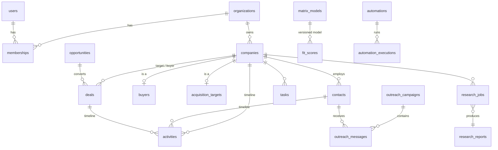

# Database design

PostgreSQL 15+ (Supabase, Cloud SQL or embedded PGlite for local dev). Migrations: `supabase/migrations/*.sql`,
applied by `npm run db:migrate` (forward-only; each file runs in one transaction; applied names stored in
`public.schema_migrations`).

| Migration | Contents |
| --- | --- |
| `…000000_auth_compat.sql` | `auth` schema, `auth.uid()` shim (reads `request.jwt.claim.sub`) and `authenticated`/`anon` roles when not on Supabase |
| `…000100_core_schema.sql` | All tables, indexes, helper functions, audit and `updated_at` triggers |
| `…000200_rls.sql` | RLS policies and grants |
| `…000300_retention.sql` | `purge_expired_data(soft_delete_days, audit_days)` |
| `…000400_task_follow_ups.sql` | `tasks.follow_up_notified_at` for exactly-once follow-up events |

## Entities

| Group | Tables |
| --- | --- |
| Tenancy & identity | `organizations`, `users`, `memberships` (role), `auth_tokens` (hashed refresh tokens) |
| CRM | `companies` (normalized name, unique domain per org, tags, custom_fields jsonb, soft delete), `contacts` (unique email per org, `email_status`), `buyers`, `acquisition_targets`, `opportunities`, `deals`, `activities` (idempotent `external_ref`), `tasks` |
| Research & AI | `research_jobs` (queue), `research_reports` (claims + sources jsonb, review flag), `ai_analyses` (public analyzer, consent + `expires_at`), `leads`, `reddit_signals` |
| Scoring | `matrix_models` (key + version, one active per key), `fit_scores` (full result jsonb, CRM sync timestamp), `buyer_bucket_rules` |
| Outreach | `outreach_campaigns` (check constraint: approved states require `approved_by`), `outreach_messages`, `suppression_list`, `communication_templates`, `newsletters` (same approval constraint), `newsletter_subscribers` |
| Automation | `automations` (definition jsonb), `automation_executions` (steps log, dedupe unique index, `resume_at`) |
| Integrations | `integrations` (non-secret config + `secret_ciphertext`), `external_crm_mappings`, `webhook_events` (idempotency) |
| Audit | `audit_logs` (actor, action, table, field-level diff; secrets stripped) |

## Integrity & performance
- Foreign keys everywhere; `on delete cascade` from organisation down, `set null` for soft links.
- Check constraints for enums, lowercase emails, non-negative values, approval invariants.
- Partial unique indexes: `companies(organization_id, domain)` and `contacts(organization_id, email)` where not deleted;
  `automation_executions(automation_id, dedupe_key)`; `activities(organization_id, type, external_ref)`.
- Queue indexes on `(status, run_after)` / `(status, resume_at)`; GIN index on `companies.tags`.

## Row-Level Security
- Read: `public.is_org_member(organization_id)`. Insert/update: owner/admin/analyst. Delete: owner/admin.
- `memberships` writes: owners only. `audit_logs`: admins read, nobody writes directly (trigger is `security definer`).
- `auth_tokens`, `webhook_events`: no policies → inaccessible to client roles. `integrations.secret_ciphertext` column revoked.
- The server runs requests as `authenticated` (see `packages/db/src/context.ts`); system jobs use `asSystem()` with an explicit actor.

## Retention
`purge_expired_data()` deletes expired analyzer results, soft-deleted companies/contacts after 30 days, stale tokens and
audit rows older than ~2 years. `apps/workers` runs it daily. No destructive production operations are run automatically
beyond these windows.

## Seed
`SEED_PASSWORD=… npm run db:seed` (refuses in production) creates the fictional "Tuck Advisors" org, four users (one per role),
six companies, contacts, deals, tasks, activities, the default matrix, bucket rules, a template and a subscriber.
