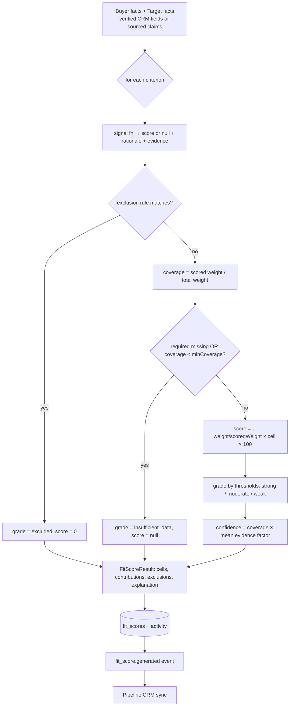

# M&A Matrix & AI Fit Score

Scoring is deterministic and explainable, implemented in Python (`services/ai-research/tuck_scoring`) and called by the web
app/engine via `ScoringClient` (`POST /v1/score`). Models are stored per organisation in `matrix_models` with immutable
versions; `fit_scores.matrix_model_id` pins each score to the version used.

## Model definition (`matrixModelInput`, `packages/shared/src/matrix.ts`)
- `criteria[]`: `key`, `label`, `signal`, `weight` (0–100), `required`, `params`
- `exclusions[]`: `field` (industry, geography, business_model, tags, employee_range), `operator` (in, not_in, contains), `values`, `appliesTo` (target|buyer)
- `thresholds`: `strong` (default 70), `moderate` (45); `minCoverage` (default 0.5)

## Signals (`signals.py`)
| Signal | Inputs | Notes |
| --- | --- | --- |
| industry_overlap | industry, industryKeywords | token overlap with synonym groups |
| business_model_alignment | businessModel | normalised model classes |
| product_synergy | products | list overlap |
| customer_overlap | customerSegments | list overlap |
| geographic_synergy | geographies | regions mapping |
| scale_compatibility | employeeCount, revenueUsd (only if `revenueVerified`) | `params.idealMaxRatio` (default 0.5) |
| strategic_fit | strategicThemes, tags | |
| acquisition_criteria | params: industries, geographies, minEmployees, maxEmployees, requiredTags | |

Each returns `(score ∈ [0,1] | None, rationale, evidence source ids)`.

## Calculation

The explanation lists overall result, strongest drivers, weak areas, missing data and exclusions — shown in the analyzer,
company page and matrix page. Missing data never silently becomes zero: it lowers coverage and confidence, or blocks scoring.

## Buyer buckets
`buyer_bucket_rules` rows (bucket, priority, `rule` = array of `{field, operator, values}`), lowest priority wins, all
conditions must match (`POST /v1/classify-buyer`). Edited in **M&A Matrix → Buyer bucket rules**.

## CRM write-back
`syncCompanyToExternalCrm` upserts the company in Pipeline CRM and writes the latest score/grade into the account-specific
custom fields `PIPELINE_CRM_FIT_SCORE_FIELD` / `PIPELINE_CRM_FIT_GRADE_FIELD`, recording ids in `external_crm_mappings` and
`fit_scores.synced_to_crm_at`.

## Batch scoring (Cloud SQL / Supabase)
`DATABASE_URL=… python -m tuck_scoring.batch --org <uuid> --model-key default-ma-matrix [--dry-run]` scores all
`kind='buyer'` × `kind='target'` companies with the active model and inserts `fit_scores`.
