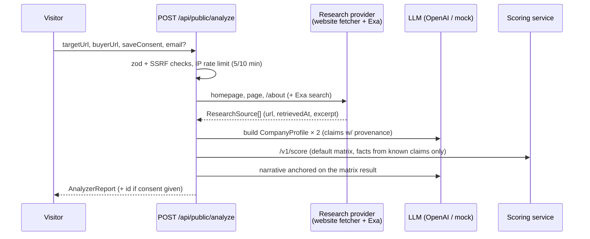

# Public platform

Routes live in `apps/web/src/app/(site)`; shared chrome in `components/site/chrome.tsx`.

| Page | Path |
| --- | --- |
| Home | `/` |
| About | `/about` |
| Advisory services | `/services` |
| Sell-side / Buy-side | `/services/sell-side`, `/services/buy-side` |
| Acquisition criteria | `/acquisition-criteria` |
| Contact (lead form) | `/contact?interest=sell_side\|buy_side` |
| M&A Analyzer | `/analyzer` |
| Privacy / Terms (templates — legal review required) | `/privacy`, `/terms` |
| Unsubscribe | `/unsubscribe?t=<token>` or `?e=<email>&o=<org>` |

Design: Fraunces (serif display) + Inter, navy `#0F1B2D`, ivory `#F7F4EE`, brass `#B08D57`; tokens in `globals.css` with
dark mode via `prefers-color-scheme`; responsive down to phone width; skip link and labelled forms.

## M&A Analyzer

- Each claim is labelled **Sourced** (cites retrieved sources), **AI assessment**, or **Unknown**. Revenue is `unknown` unless a
  source explicitly states it.
- If the scoring service is unavailable the report shows `insufficient_data` instead of a number.
- Report includes sources with retrieval timestamps and `ANALYZER_DISCLAIMER` (not financial/legal/investment/valuation advice).
- Saved only with explicit consent into `ai_analyses` (auto-deleted after 180 days).
- Lead form beneath the report links the analysis id to the inquiry.

## Lead generation
`POST /api/public/leads` (consent required, hidden honeypot field, IP rate limit) → `leads` row + a `system` activity on the
public organisation's timeline. `POST /api/public/subscribe` / `unsubscribe` manage newsletter consent; hard bounces and
complaints cannot be re-subscribed.
